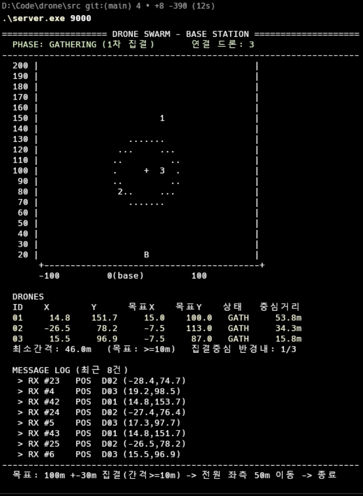

# 드론 군집 제어 시스템 (Drone Swarm Control System)




TCP 기반 **다중 쓰레드 기지국 서버**가 **N(≥3)대의 드론 클라이언트**를
**1차 이동(군집 집결)** → **2차 이동(일괄 좌측 50m)** → **종료** 순으로 제어하는
분산 제어 시스템. C / Winsock 2.2, 『열혈 TCP/IP』 Ch.20 멀티쓰레드 예제 기반.

## 파일 구성

| 파일 | 역할 |
|------|------|
| `src/protocol.h` | 공유 메시지 구조체와 영역·주기 상수 |
| `src/server.c` | 접속 수락, 드론별 수신, 군집 제어, 콘솔 렌더링 |
| `src/drone.c` | 위치 보고, 명령 수신, 이동 시뮬레이션 |
| [README.md](README.md) | 프로젝트 소개, 빌드·실행 안내 |
| [spec.md](spec.md) | 기능·제어·통신 규칙과 화면·완료 기준 |
| [plan.md](plan.md) | 기술 구조와 남은 작업 |

## 빌드 및 실행

Windows에서 저장소 루트 기준으로 `cd src`를 실행한 뒤 아래 명령을 사용합니다.

### 빌드 (Windows)

#### 방법 1) MinGW gcc — 이 프로젝트에서 사용한 방법
```bat
gcc server.c -o server.exe -lws2_32
gcc drone.c  -o drone.exe  -lws2_32
```
> WinLibs gcc 설치: `winget install BrechtSanders.WinLibs.POSIX.UCRT`
> (설치 직후 같은 셸에는 PATH 미반영 → 새 터미널 사용)

#### 방법 2) Developer Command Prompt (MSVC `cl`)
```bat
cl /nologo server.c /Fe:server.exe /link ws2_32.lib
cl /nologo drone.c  /Fe:drone.exe  /link ws2_32.lib
```

#### 방법 3) Visual Studio
- 콘솔 응용(Console App) 프로젝트 2개 생성 → 각각 `server.c`, `drone.c` + `protocol.h` 추가.
- 프로젝트 속성 → 링커 → 입력 → 추가 종속성에 `ws2_32.lib` 추가.
  (소스의 `#pragma comment(lib, "ws2_32.lib")` 로 자동 링크되므로 보통 생략 가능.)

### 실행
```bat
REM 1) 서버 (포트 9000)
server.exe 9000

REM 2) 드론 3대 이상 (다른 콘솔에서)
drone.exe 127.0.0.1 9000 D1
drone.exe 127.0.0.1 9000 D2
drone.exe 127.0.0.1 9000 D3
```
> 서버·드론 모두 시작 시 콘솔을 UTF-8로 설정(`SetConsoleOutputCP(CP_UTF8)`)하므로
> 한글 레이더/상태표/로그가 깨지지 않습니다.

### 동작 흐름 (자동 진행)
1. **INIT** — 드론들이 영역 내 임의 위치에서 배회. 3대 이상 접속·보고되면 →
2. **GATHERING** — 서버가 각 드론에 집결 목표(중심 (0,100), 반경 15m 원주) `MOVE_CMD` 송신.
   전원이 반경 30m 내 + 상호 간격 ≥ 10m 가 되면 →
3. **GATHERED → SHIFTING** — 서버가 전원에게 "현재 X − 50m" 2차 목표 송신. 전원 도달하면 →
4. **DONE** — 서버가 `TERMINATE` 송신, 모든 프로그램 종료.

서버 콘솔에는 실시간 **레이더 / 상태표 / 메시지 로그** 3패널이 표시됩니다([화면 기준](spec.md#화면-기준)).

### 결과보고서용 캡처 포인트
- INIT(배회) / GATHERING / GATHERED / SHIFTING / DONE 각 페이즈의 서버 레이더 화면
- 상태표의 "최소간격 ≥ 10m", "중심거리 ≤ 30m" 수치 (제약 충족 증빙)
- MESSAGE LOG 패널의 POS(RX)/MOVE·TERM(TX) 송수신 내역
- 드론 콘솔의 위치 보고 / 명령 수신 로그

## 참고 자료

- [프로젝트 설명.pdf](docs/프로젝트%20설명.pdf) — 과제 명세
- [프로젝트 결과보고서.pdf](docs/프로젝트%20결과보고서.pdf) — 최종 결과 보고서
- 기준 예제: 『윤성우의 열혈 TCP/IP 소켓 프로그래밍』 Chapter20 `chat_serv_win.c` · `chat_clnt_win.c`
